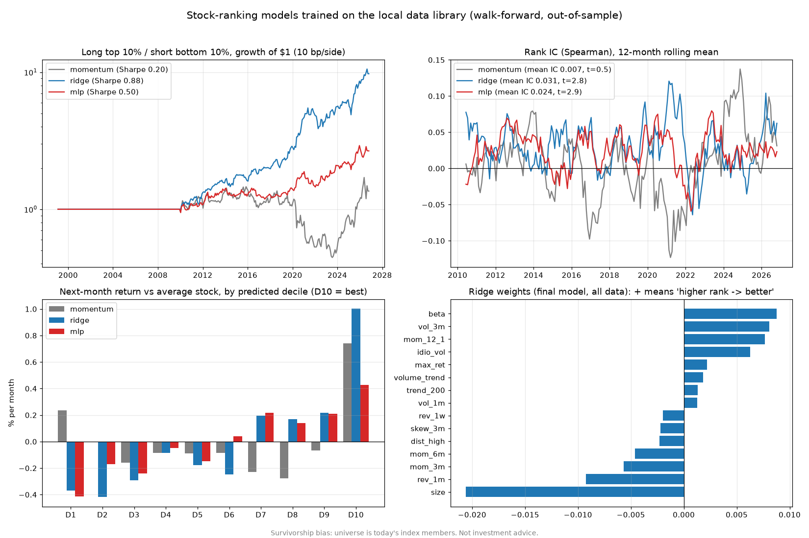

# Quant Research

Trading algorithms, market scans and forecasts, each tested on past data and reported honestly.

## See every chart on the website: [sebastien988.github.io/qaunt-stuff](https://sebastien988.github.io/qaunt-stuff/)

[](https://sebastien988.github.io/qaunt-stuff/)

> Educational research, not financial advice. Charts describe the past and statistical forecasts; most of the forecasts here did not beat simple baselines, and the reports say so.

## Algorithms

| Script | What it does | Charts | Report |
|---|---|---|---|
| [`bond_scan.py`](bond_scan.py) | Scan bond markets: yield, recent returns and risk, saved as a PNG | [bond_scan.png](bond_scan.png) | - |
| [`combined_algo.py`](combined_algo.py) | Multi-strategy, multi-asset trading algorithm with a backtest | [combined.png](combined.png) | - |
| [`compare_chart.py`](compare_chart.py) | Chart every algorithm in this folder against the S&P 500 | [comparison.png](comparison.png) | - |
| [`crypto_scan.py`](crypto_scan.py) | Pick crypto coins to hold for the next two weeks, and test how the rule did | [crypto_scan.png](crypto_scan.png) | - |
| [`download_data.py`](download_data.py) | Build a local ~1 GB market-data library in ./data | - | - |
| [`industrial_prediction.py`](industrial_prediction.py) | Predict the US industrial sector and its largest companies | [industrial_prediction.png](industrial_prediction.png) | [industrial_prediction.md](industrial_prediction.md) |
| [`market_scan.py`](market_scan.py) | Rank markets by recent strength and by price/earnings ratio, as PNGs | [market_scan.png](market_scan.png), [market_top10.png](market_top10.png) | - |
| [`nvidia_learning.py`](nvidia_learning.py) | Nvidia prediction that keeps learning: every run searches for a better model | [nvidia_learning.png](nvidia_learning.png) | [nvidia_learning.md](nvidia_learning.md) |
| [`nvidia_prediction.py`](nvidia_prediction.py) | Predict Nvidia's share price move from the tone of the news about it | [nvidia_prediction.png](nvidia_prediction.png) | [nvidia_prediction.txt](nvidia_prediction.txt) |
| [`quant_research.py`](quant_research.py) | Quant research with standard textbook formulas, numpy only | [quant_research.png](quant_research.png) | [quant_research.md](quant_research.md) |
| [`sector_chart.py`](sector_chart.py) | Chart each US stock-market sector over the past ten years | [sector_chart.png](sector_chart.png) | - |
| [`trading_algo.py`](trading_algo.py) | Moving-average crossover trading strategy, trained by walk-forward optimisation | [backtest.png](backtest.png) | - |
| [`train_models.py`](train_models.py) | Train stock-ranking models on the local data library (./data), walk-forward | [train_models.png](train_models.png) | [train_models.md](train_models.md) |
| [`trained_algo.py`](trained_algo.py) | Train the combined algorithm to beat the S&P 500, then test it on unseen data | - | - |

## Run it yourself

```
python -m venv .venv
.venv/bin/pip install -r requirements.txt
.venv/bin/python quant_research.py     # or any other script
```

Each script downloads its own data (Yahoo Finance, and GDELT for news tone) and saves a PNG next to itself.

## Updating the website

`python publish.py` rebuilds the website from every PNG in the folder, rewrites this README, commits and pushes. New algorithms are picked up automatically.

*This README is written by `publish.py`; edits made here by hand are overwritten.*
